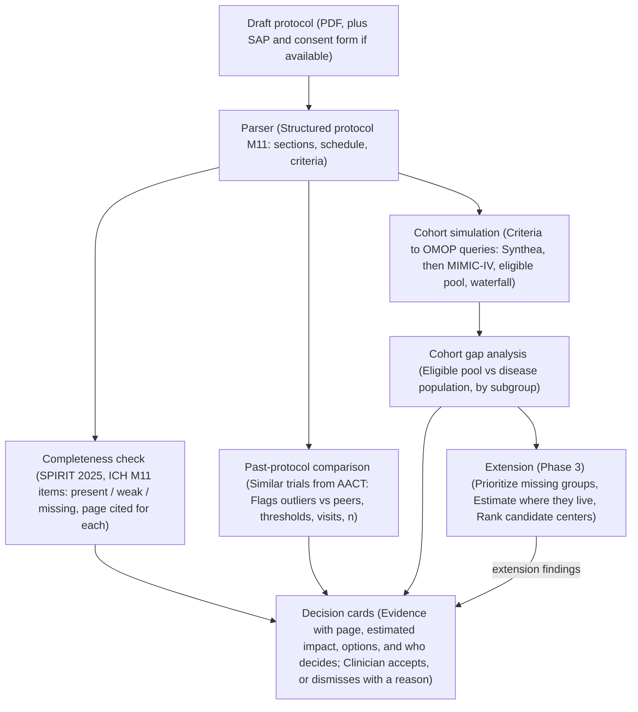

# Protocol Gap Agent — Project Plan

## System Design

## Abstract

Clinical trial protocols are often amended and often fail to enroll: 57% have at least one substantial amendment, about 45% of those amendments are avoidable, and about 18% of cooperative-group cancer trials close for low accrual or fall far behind target. Many of these problems are visible in the protocol before the trial starts.

We propose an agent that reviews a draft protocol in four steps:

1. **Completeness**: checks the protocol against the SPIRIT 2025 checklist and the ICH M11 template, and flags missing or weak elements (e.g. no estimand, no stopping rule).
2. **Comparison with past protocols**: retrieves similar trials from ClinicalTrials.gov and flags where this protocol is unusual: stricter thresholds, heavier visit schedules, optimistic sample-size assumptions.
3. **Cohort completeness**: converts the eligibility criteria into computable queries, simulates them on patient data, and shows which patient groups are under-represented compared with the disease population, and which criteria cause it.
4. **Extension, locating missing patients**: estimates where the excluded or under-represented patients are, ranks candidate centers by likelihood of reaching them, and prioritizes subgroups by their importance to the trial.

Each finding is a decision card: the evidence (page and section), the estimated impact, options, and who decides. The agent proposes; clinicians decide. We evaluate it retrospectively on completed trials, asking whether it would have flagged the criteria that were later amended, predicted terminations for low accrual, and matched the demographics that actually enrolled.

## Does the Idea Hold Up?

Yes. The four parts ask one question at widening scope: is this protocol complete, typical, inclusive, and recruitable? The core runs entirely on public data, and completed trials give us a built-in way to validate it.

Three points need sharpening before we build:

1. **"Similar past protocols" needs a definition.** Similar = same condition, same phase, same intervention class, started in the last ~10 years. The comparison flags outliers; it doesn't call them errors. Common is not the same as correct, and a stricter threshold can be deliberate.
2. **"Cohort completeness" means coverage of the intended-use population, not everyone.** We compare the simulated eligible pool with everyone who has the disease, subgroup by subgroup: age, sex, race/ethnicity, kidney/liver function, comorbidities. A gap is a subgroup whose share drops sharply between the two, traced back to the criteria that cause the drop.
3. **"Priority of missing patients" needs explicit, adjustable weights.** Proposed factors:

| Factor | Question it answers | Example |
| :--- | :--- | :--- |
| **Disease burden** | How big a share of patients with the disease is this group? | Patients 65+ in lung cancer |
| **Clinical and safety relevance** | Do we need data on this group to use the drug safely? | Renal impairment for a renally cleared drug; elderly patients (ICH E7) |
| **Regulatory expectation** | Do regulators expect this group to be represented? | Groups named in a Diversity Action Plan |
| **Statistical need** | Does the analysis plan pre-specify this subgroup? | A subgroup analysis that needs a minimum `n` |
| **Scientific value** | Might the drug work differently in this group? | Biomarker-defined groups, known effect modifiers |

The priority score is a weighted sum of these factors. The clinical lead sets the weights and the tool shows them, so nobody mistakes the ranking for an objective truth.

**What to watch:** The locating step (extension) only has county-level public data, so its output is an estimate. Scope is the biggest risk for five people, so we build the core end to end on one disease area before adding anything else.

## Data Sources

Everything the core needs is public or open after a short credentialing step. The extension adds public, county-level population data.

| Source | Used for | Access | Phase |
| :--- | :--- | :--- | :--- |
| **[AACT](https://aact.ctti-clinicaltrials.org/)** (ClinicalTrials.gov as Postgres) | Criteria, sites, status, termination reasons, enrolled baseline demographics | Public | Core |
| **ClinicalTrials.gov protocol and SAP PDFs** | Corpus of past protocols for comparison | Public | Core |
| **ClinicalTrials.gov History of Changes** | Ground truth for which criteria were later amended | Public | Core (evaluation) |
| **SPIRIT 2025 checklist, ICH M11 template** | Completeness rubric | Public | Core |
| **Synthea** | Synthetic patients to develop the pipeline (not for conclusions) | Public | Core |
| **MIMIC-IV** | Real EHR data for cohort simulation | PhysioNet credentialing (CITI training) | Core |
| **OMOP vocabularies (Athena)** | Concept sets for computable criteria | Free registration | Core |
| **All of Us** | More diverse real-world data | Researcher application | Phase 2 |
| **FDA Drug Trials Snapshots** | Enrolled demographics of pivotal trials | Public | Phase 2 (evaluation) |
| **SEER / US Cancer Statistics, CDC PLACES** | Disease burden by county | Public | Extension |
| **Census ACS** | Demographics by county | Public | Extension |
| **CMS Part D prescribers, Medicare physician data, NPPES** | Which doctors treat the disease, and where | Public | Extension |

> [!NOTE]
> MIMIC-IV is a single center and mostly ICU patients, so it is not representative of most outpatient trial populations. Use it to test the method, and state that limit in every result.

---

## Phase 1: Core

**Goal:** One protocol in, one report out, end to end, for one disease area. Done when the agent produces a report on any protocol in our corpus, and we have a retrospective evaluation on a held-out set of trials.

### Step 1: Pick the Disease Area and Build the Corpus

- **Action:** Pull every trial in the chosen disease area from AACT (Aggregate Analysis of ClinicalTrials.gov) that has an associated protocol PDF, plus its History of Changes and termination reason.
- **Corpus Contents:** Protocol PDFs, Statistical Analysis Plans (SAPs), informed consent forms (when available), and longitudinal amendment histories.
- **Metadata Harvested:** Detailed trial metadata including phase, intervention class, official title, sponsor type (industry vs. academic), start year, enrollment targets, actual accrual, and termination status/reasons.

### Step 2: Parse Protocols into a Shared Structure

- **Action:** Convert unstructured protocol PDFs into standardized JSON format.
- **Shared Schema (The System Contract):**
  - Section contents mapped to standard **ICH M11** headings.
  - The **Schedule of Activities (SoA)** extracted as an explicit, structured visit × procedure table.
  - Each **eligibility criterion** represented as its own discrete item, preserving verbatim text, categorization (inclusion vs. exclusion), and context.
- **Parser Design & Validation:**
  - Build the parser as an agent that classifies sections by substantive semantic content rather than superficial heading names.
  - This schema acts as the foundational contract between all downstream modules and must be finalized and frozen first.
  - Evaluate extraction accuracy and section classification against a held-out gold set of hand-labeled protocols (covering both industry and academic trials) before downstream components build on it.

### Step 3: Completeness & Consistency Checker

#### Completeness Checker
- **Evaluation Framework:** Score each item from the **SPIRIT 2025** checklist and **ICH M11** template as `present`, `weak`, or `missing`, with mandatory citations of exact document page numbers.
- **Standardized Rubric:** Each checklist item corresponds to a rubric entry detailing explicit requirements and providing concrete examples of `present`, `weak`, and `missing` implementations.
- **Three-Way Validation Methodology:**
  1. *Independent Clinical Labeling:* A doctor and a biomedical engineer label protocols independently. Their inter-rater agreement defines the empirical performance ceiling; the agent is scored against their consensus.
  2. *Deletion Test:* Remove specific sections or elements from complete, compliant protocols and verify that the agent systematically detects and flags the omissions.
  3. *Evidence Check:* An automated verification pass ensuring that every quote cited by the agent exists verbatim in the source document and directly supports the assigned score.

#### Consistency Checks (Biomedical Engineer)
- **Failure Modes Caught:** Endpoints defined in the text that are never collected in the schedule of activities, clinical procedures scheduled in the protocol that are missing from the informed consent form, or contradictory visit windows between text narrative and schedule tables.
- **Mechanism:**
  - Extract every visit, procedure, and endpoint from the protocol body text, Schedule of Activities table, Statistical Analysis Plan (SAP), and consent form into unified comparative lists.
  - Cross-compare extracted lists across document boundaries.
  - An LLM evaluates potential discrepancies to judge whether each mismatch constitutes a genuine operational or clinical contradiction.
- **Output:** One dedicated decision card per validated mismatch, citing and quoting both contradictory document passages side-by-side.

### Step 4: Comparison with Past Protocols

- **Retrieval:** Retrieve the most similar peer trials from AACT based on matching clinical condition, trial phase, intervention class/mechanism, and start date (within the last ~10 years).
- **Core Comparison Dimensions:** Start from a fixed list of approximately 10 structured dimensions agreed upon with the clinical doctor:
  1. Laboratory thresholds (e.g., eGFR, AST/ALT, platelets, ANC)
  2. Age boundaries (minimum and maximum limits)
  3. Performance status requirements (e.g., ECOG / Karnofsky thresholds)
  4. Washout periods (durations required off prior therapies)
  5. Total number and breadth of exclusion criteria
  6. Visit frequency and number of invasive procedures
  7. Sample size target and underlying design assumptions
  8. Primary and secondary endpoint types
  9. Overall trial duration and follow-up timeline
  10. Essential protocol elements common across peer trials
- **Outlier Detection ("Peer Data Defines Normal"):**
  - Flag parameters outside the 10th–90th percentile of peer trials (e.g., requiring eGFR ≥ 60 mL/min when 85% of peers accept ≥ 45 mL/min).
  - No hard-coded or arbitrary "correct" values; normal is derived entirely from peer empirical distributions.
- **Phase 2 Extensibility:** In Phase 2, users gain interactive controls to filter peer sets (by calendar years, industry vs. academic sponsors, geography/regulatory region), toggle active comparison dimensions, and introduce ad-hoc plain-language check rules.

### Step 5: Turn Criteria into Computable Queries

- **Translation Engine:** Decompose every free-text eligibility criterion into structured computable logic:
  $$\text{Criterion} \longrightarrow \big[\text{Clinical Concept},\ \text{Value Threshold},\ \text{Time Window},\ \text{Negation Status}\big] \longrightarrow \text{OMOP Concept Set}$$
  *Example:* "Exclude eGFR <60 within 28 days before enrollment" decomposes to Concept = eGFR lab measurement, Threshold = < 60 mL/min, Window = 28 days prior to enrollment index, Negation = true (must not match).
- **Standardized Vocabularies & Portability:**
  - Map concepts to standardized OMOP Common Data Model vocabularies (via Athena) to group all synonymous clinical and billing codes.
  - Because Synthea and MIMIC-IV provide established OMOP mappings, the identical cohort query runs portably across both datasets.
  - Execution handled via OHDSI ecosystem tools (ATLAS cohort definitions and SQL generation).
- **Explicit Limits & Verification:**
  - Criteria that clinical data cannot reliably express (e.g., subjective ECOG scores, clinical life expectancy, specific prior intolerance nuances) are explicitly tagged as `"cannot simulate"` rather than guessed.
  - A clinician manually audits a representative sample of translated queries against source criteria to verify semantic fidelity.

### Step 6: Simulate the Cohort

- **Staged Execution:**
  - First, run and debug computable queries on **Synthea** synthetic patient records during active pipeline development.
  - Second, execute validated queries on real-world electronic health records in **MIMIC-IV** (with PhysioNet CITI-credentialed access).
- **Output:** Total eligible patient count, followed by a full attrition waterfall tracking exactly how many candidate patients each consecutive criterion excludes.

### Step 7: Analyze Cohort Gaps

- **Subgroup Representation Analysis:** Compare the demographic and clinical profile of the simulated eligible pool against the baseline disease population across key strata: age brackets, biological sex, race/ethnicity, renal/hepatic function stages, and common comorbid conditions.
- **Root-Cause Identification:** Pinpoint the specific criteria that drive the steepest drop-offs in representation for vulnerable or target subgroups.
- **Peer Cohort Benchmarking:**
  - Simultaneously execute the eligibility criteria of peer comparator trials on the exact same patient cohort.
  - Benchmark the proportion of total patients and specific demographic subgroups retained by this protocol versus peer trials.
  - **Diagnostic Value:** Clearly distinguishes between criteria that are strict but standard practice for the therapeutic field versus idiosyncratic restrictions that represent an unforced trial-specific recruitment problem.

### Step 8: Report as Decision Cards

- **Standardized Card Architecture:** Every flagged finding is packaged into a discrete, actionable decision card containing:
  - *Evidence:* Exact quotation with document page and section reference.
  - *Estimated Impact:* Quantitative effect on eligible patient pool, subgroup accrual, or operational burden.
  - *Options:* Pragmatic alternative paths (e.g., align threshold with peer standard, introduce stratified safety monitoring, accept remote lab draws).
  - *Decision Routing:* Designates who owns the decision (e.g., Principal Investigator, Medical Monitor, Study Biostatistician, Clinical Operations Lead).
- **Accountability:** The agent proposes; human clinical teams decide. If a recommendation is dismissed, the user must log a structured reason, capturing organizational rationale and preserving an audit trail.

---

## Phase 2: Further Features

**Goal:** Make findings deeper and directly actionable. Each feature stands alone as a modular capability that can be prioritized and built independently once the core pipeline is operational.

### 1. Burden Score (Biomedical Engineer)
- **Measures:** Overall patient and site burden quantified through number of in-person clinic visits, frequency of invasive procedures (e.g., tissue biopsies, contrast-enhanced CT/MRI scans), volume and cadence of blood draws, and cumulative hours per visit.
- **Methodology:**
  - Transform the Schedule of Activities table into an explicit visit × procedure matrix.
  - Assign standardized weightings to procedures according to invasiveness, discomfort, risk, and time commitment (weights calibrated in consultation with the clinical doctor).
  - Benchmark the cumulative trial score against peer-trial percentiles in the same phase and indication.
- **Output:** An aggregate Protocol Burden Score, a breakdown of top operational cost and burden drivers, and explicit identification of visits that could be conducted remotely or locally (e.g., electronic patient-reported questionnaires, decentralized safety lab draws).

### 2. Statistical Sanity Check (Computer Scientist 2)
- **Methodology:**
  - Extract declared sample-size design assumptions from the protocol and SAP: expected treatment effect size, assumed control-arm event or response rate, projected patient dropout/lost-to-follow-up rate, and target statistical power ($1 - \beta$) at significance level $\alpha$.
  - Recompute the statistical power and required sample size using standard formulas.
  - Compare the assumed control-arm event rate with actual historical outcomes posted by completed peer trials in AACT.
- **Output:** Automated sanity flag whenever protocol assumptions are unrealistically optimistic (e.g., underestimating control event rates or assuming negligible dropouts), presented alongside empirical peer trial benchmarks.

### 3. What-If Relaxations (Computer Scientist 2 + Doctor)
- **Methodology:**
  - Precompute cohort simulation passes across stepped relaxation tiers for restrictive numerical lab criteria (e.g., evaluating eGFR thresholds at ≥ 60, ≥ 45, and ≥ 30 mL/min; or platelet cutoffs at ≥ 100k, ≥ 75k, and ≥ 50k/μL).
  - Cache results in memory to enable instantaneous UI slider responses without requiring live database re-queries.
- **Output:** Live display showing the incremental number and percentage of patients recovered—both overall and stratified per demographic/clinical subgroup—paired with the prerequisite clinical safety questions that the team must resolve (e.g., "Is the investigational product cleared renally or hepatically?").

### 4. Amendment-Risk Model (Computer Scientist 2)
- **Data Formulation:** Extract historical protocols and their associated ClinicalTrials.gov History of Changes; label each original criterion as having undergone a subsequent protocol amendment (`amended = 1`) or remained unchanged (`amended = 0`).
- **Feature Engineering:** Parameterize criteria by semantic criterion category (lab threshold, washout, comorbid exclusion, diagnostic test), relative strictness compared to peer trial percentiles, trial phase, sponsor type (industry vs. academic/consortium), and therapeutic indication.
- **Modeling & Evaluation:**
  - Train baseline logistic regression and gradient-boosted decision tree classifiers.
  - Evaluate predictive performance using AUROC (Area Under the Receiver Operating Characteristic curve) on a strictly held-out test set of historical trials.
- **Output:** Calibrated amendment risk score per eligibility criterion, flagging restrictions most prone to mid-trial revision.

### 5. Before/After View (Computer Scientist 1)
- **Methodology:** Rerun the entire end-to-end analytical pipeline on an edited or proposed protocol revision.
- **Output:** Comparative delta view illustrating net change in the eligible patient pool, improvements in under-represented subgroup coverage, shift in Protocol Burden Score, and an audit status of previously flagged findings (resolved, partially addressed, or newly introduced).

### 6. Draft Amendment Text (Computer Scientist 1)
- **Methodology:** When a clinical team selects an option on a decision card to modify an eligibility criterion or visit procedure, an LLM drafts publication-ready redlined protocol wording.
- **Supporting Rationale:** Automatically generates an accompanying regulatory and scientific rationale paragraph, synthesizing citations from peer trials, FDA guidance, and drug label pharmacology.
- **Human Oversight:** All drafted modifications require explicit review, editing, and approval by authorized clinical personnel before export.

---

## Phase 3: Extensions

**Goal:** Turn "who is missing" into "where to find them". Every output produced in this phase represents an aggregated estimate at the county or medical center level, never disclosing or handling individual patient records. This phase serves as the primary centerpiece for interactive demonstration.

### 1. Prioritize Missing Subgroups (Doctor)
- **Gap Calculation:** For each patient subgroup $g$, compute the clinical representation gap:
  $$\text{Gap}_g = \text{Share of Disease Population}_g - \text{Share of Eligible Pool}_g$$
- **Multi-Factor Scoring:** Evaluate each identified gap using a weighted sum across the five validated dimensions established in the system design:
  - *Disease burden:* Proportion of total disease incidence/prevalence represented by this group.
  - *Clinical and safety relevance:* Necessity of safety/pharmacokinetic data for real-world prescribing (e.g., renal impairment, elderly populations under ICH E7).
  - *Regulatory expectation:* Prioritization within FDA Diversity Action Plans and regulatory mandates.
  - *Statistical need:* Pre-specified subgroup analysis requirements in the SAP requiring adequate statistical power (`n`).
  - *Scientific value:* Suspected heterogeneity of treatment effect, known pharmacogenomic modulators, or biomarker differences.
- **Weight Governance & Sensitivity Check:**
  - Weights are managed in an editable configuration file curated by the clinical lead, ensuring transparent governance rather than opaque agent heuristics.
  - Robustness check: Test whether the resulting priority ranking shifts when each individual weight is perturbed by ±20%.
- **Output:** A ranked prioritization list of under-represented subgroups, each accompanied by a concise, one-line clinical justification.

### 2. Estimate Where They Are (Data Engineer + Computer Scientist 2)
- **County-Level Estimation Formula:** For each county, estimate the pool of eligible and missing subgroup patients:
  $$\hat{N}_{g,\text{county}} = \text{Disease Cases}_{\text{county}} \times \text{Subgroup Share}_{\text{county}} \times \text{Subgroup Pass Rate}_{\text{sim}}$$
  - *Disease Cases:* Regional incidence/prevalence derived from SEER, US Cancer Statistics, or CDC PLACES.
  - *Subgroup Share:* Demographic distributions from US Census American Community Survey (ACS) and localized chronic comorbidity prevalence from CDC PLACES.
  - *Subgroup Pass Rate:* Empirical fraction of subgroup $g$ surviving trial criteria in the OMOP cohort simulation.
- **Uncertainty Quantification:** Bootstrap the simulation pass rates to output a confidence interval / plausible range rather than a deceptive point estimate.
- **Governing Assumption:** Every location output explicitly documents the foundational modeling assumption that a subgroup's criteria pass rate remains consistent across geographic regions.

### 3. Narrow the Centers (Computer Scientist 2)
- **Candidate Center Identification:** Extract hospitals, health systems, and specialty clinics from NPPES (National Plan and Provider Enumeration System) verified to handle real disease volume using CMS Medicare physician utilization data and CMS Part D prescriber registries for relevant therapeutic classes.
- **Catchment Area Modeling:** Define the geographic catchment area around each facility using a radial distance threshold (e.g., 50 miles) initially, progressing to road network drive-time isochrones in later iterations.
- **Output:** Ranked center recommendations accompanied by plain-language rationales (e.g., *"Large pool of patients aged 65+ with CKD within 50 miles, no active competing trials nearby, historical site for 2 successful peer trials"*).

### 4. Account for Competing Trials (Data Engineer)
- **Identification:** Query AACT for actively recruiting trials in the same disease indication whose eligibility criteria overlap with the candidate trial (benchmarked by running both criteria sets on the shared simulated cohort) and that operate active trial sites within the center's catchment area.
- **County / Catchment Saturation Metric:**
  $$S_c = \frac{\sum \text{Enrollment Targets of Competing Recruiting Trials}}{\text{Estimated Total Eligible Patients in Catchment Area}}$$
  Bounded between 0 (no competition) and 1 (fully saturated recruitment environment).

### 5. Map View (Computer Scientist 1 + Data Engineer)
- **Interactive Geospatial Visualization:**
  - County polygons shaded choropleth-style by the density of estimated missing high-priority patients.
  - Candidate clinical centers rendered as interactive map pins, sized proportionally to their center ranking score.
  - Overlay of existing active trial sites to visualize geographic coverage voids.
- **Dynamic Interaction:** Interactive subgroup filter toggles linked bidirectionally to the Phase 2 what-if relaxation slider, such that loosening an eligibility criterion dynamically updates the map shading, patient counts, and center rankings in real time.

### 6. Optional: Voice Screening Interview
- **Demonstration Showcase:** A simulated interactive patient voice prescreening agent designed for the project demo.
- **Purpose:** Inquire about practical trial participation barriers that electronic health records never document (e.g., transportation access, willingness to travel, visit scheduling flexibility, caregiver availability), providing a holistic recruitment feasibility assessment.

---

### Center Ranking Formula

A first ranking formula for candidate center $c$, summed over prioritized missing subgroups $g$ (to be refined in collaboration with the clinical lead):

$$\text{score}(c) = \Big[\sum_{g} w_g \cdot \hat{N}_{g,c}\Big] \cdot \big(1 - S_c\big) \cdot E_c$$

Where:
- `w_g` is the priority weight assigned to missing subgroup `g` (configured in the clinical governance settings).
- `N̂_g,c` is the estimated count of eligible patients belonging to subgroup `g` residing within the catchment area of center `c`.
- `S_c` is the recruitment saturation index from competing clinical trials in the catchment area (`0 <= S_c <= 1`).
- `E_c` is an empirical experience weighting factor reflecting center `c`'s demonstrated track record and operational volume in conducting similar clinical trials.

---

## Agent Inventory & Repository Mapping

Each step in the pipeline maps to a dedicated uAgent module in `backend/agents/` communicating via typed schemas in `backend/shared/messages.py`:

| Agent Folder | Owner | Role |
| :--- | :--- | :--- |
| `backend/agents/parser/` | Alex | Parses protocol PDFs, SAPs, and consent forms into the shared ICH M11 JSON contract (`ProtocolDocument`). |
| `backend/agents/completeness/` | Alex | Scores SPIRIT 2025 / ICH M11 rubric items (`present` / `weak` / `missing` with verified page citations) and runs cross-document consistency checks. |
| `backend/agents/comparison/` | Theo | Retrieves peer trials from ClinicalTrials.gov / AACT and flags outliers across the 10 clinical comparison dimensions. |
| `backend/agents/cohort/` | Alvaro | Translates eligibility criteria into computable OMOP queries, simulates attrition waterfalls on Synthea / MIMIC-IV, and benchmarks subgroup gaps against peer cohorts. |
| `backend/agents/extension/` | Team | Prioritizes missing subgroups, projects county-level eligible/missing counts (SEER / CDC PLACES / ACS), and ranks candidate clinical centers. |

---

## Team Responsibilities & Execution Checklist

### Define Protocol Information (Stefan)
- [x] Choose disease area: **Diabetes**
- [ ] Search source of protocols
  - [ ] Patient profile information per cohort
  - [ ] Protocol related data
- [ ] Guidelines of the protocol
- [ ] Create a set of rules template for the agent to analyze
- [ ] Find an example of the protocol to test

### Zero Step: Data Ingestion (Alex)
- [ ] Parse protocols into a shared structure (PDF to JSON)

### First Step: Completeness and Consistency Check (Alex)
- [ ] Apply Completeness & consistency checker (Based on Stefan guidelines)
- [ ] Add human in the loop to verify the completeness
  - [ ] If necessary, human must add information that the agent is not able to
- [ ] Apply automated changes to the protocol (A)

### Second Step: Protocol Comparison (Agent 2) (Theo)
- [ ] Fetch similar cohort protocols (A)
- [ ] Compares it with previous protocols using the templated rules (A)
- [ ] Formats results based on a template (A)
- [ ] Add human in the loop doctor review templated results with reasoning traces associated with each section
- [ ] Apply changes to the protocol (A)

### Third Step: Cohort Comparison (Alvaro)

#### Part 1 (Alvaro)
- [ ] Turn protocol values into rules
- [ ] Filter patients from the eligible cohort
- [ ] Fetch similar previous cohort
- [ ] Fetch information from the patients (variables)
- [ ] Filter MIMIC data according to those values

#### Part 2 (Alvaro)
- [ ] Compare cohort to previous trials (test for similar diversity, representation, feasibility)
- [ ] Name the criteria that drive the biggest drops. Also run the peer trials' criteria on the same simulated cohort, so each result is benchmarked: the share of patients and of each subgroup this protocol keeps, compared with similar trials, and which criteria explain the difference. That separates criteria that are strict but normal for the field from criteria that are a real problem for this trial.

### Fourth Step: Reporting
- [ ] Group recommendation results
- [ ] Present insightful information

### Pitch Deck
- [ ] User Journey
- [ ] Valid metrics

---

## Evaluation and Milestones

The headline result is retrospective: run the agent on the original protocols of completed trials and check its findings against what actually happened.

| Component | Metric | Ground truth |
| :--- | :--- | :--- |
| **Parser** | Extraction accuracy per section and per criterion | Hand-labeled sample of protocols |
| **Completeness checker** | Precision and recall per checklist item | Doctor and biomedical engineer labels |
| **Comparison with past protocols** | Share of flags judged real problems; hit rate on criteria later amended | Clinical review; History of Changes |
| **Criteria-to-query translation** | Share of criteria translated correctly | Doctor's review of a sample |
| **Cohort simulation and gaps** | Predicted eligible demographics vs demographics actually enrolled | Baseline results on ClinicalTrials.gov; FDA Drug Trials Snapshots |
| **Low-accrual prediction** | AUROC (area under the ROC curve) | Trials terminated for low accrual (AACT) |
| **Center ranking (extension)** | Overlap between top-ranked centers and the sites of trials that met their enrollment target | AACT site lists |

### Milestone Gates (dates to be set by the team)

- Disease area chosen and shared protocol schema agreed
- Corpus built; MIMIC-IV access granted
- Gold set labeled
- Core runs end to end on one protocol
- Retrospective evaluation of the core on the held-out set
- Phase 2 features chosen and built
- Extension prototype: priority, location, center ranking
- Demo and write-up

---

## Risks and Open Questions

| Risk | Mitigation |
| :--- | :--- |
| **Protocol PDFs parse badly (tables, scans)** | Start with the cleanest protocols; measure parser accuracy before building on it |
| **Criteria translate into the wrong queries, silently distorting counts** | Doctor reviews a sample; show the query next to each criterion in the report |
| **Patient data lacks key variables (ECOG, biomarkers, lines of therapy)** | Report those criteria as "cannot simulate" rather than guessing; choose a disease area where data is richer |
| **MIMIC-IV is not representative; Synthea is not real** | Present results as a test of the method; move to All of Us for real conclusions |
| **County-level projection assumes pass rates are the same everywhere** | Adjust with CDC PLACES; state the assumption in every location output |
| **Strict criteria can be deliberate (safety, enrichment)** | Cards offer options and route the decision to the right person; never recommend relaxing outright |
| **Scope creep across three phases** | Phase 1 end to end before anything else |

### Open Questions for the Team

- **Which disease area?** It decides most data sources. Lung cancer has strong SEER data and the Trial Pathfinder precedent; Diabetes is checked in the initial task breakdown.
- **What is the deadline, and is the goal a paper, a demo, or both?**
- **Which LLM, and what is the compute budget?**
- **Who completes CITI training for MIMIC-IV access?**
- **Project name.**

---

## Sources

- Getz et al. 2024, amendment frequency and avoidability (slide summary)
- One in five cancer trials fail to meet accrual targets
- [AACT database](https://aact.ctti-clinicaltrials.org/) (Aggregate Analysis of ClinicalTrials.gov)
