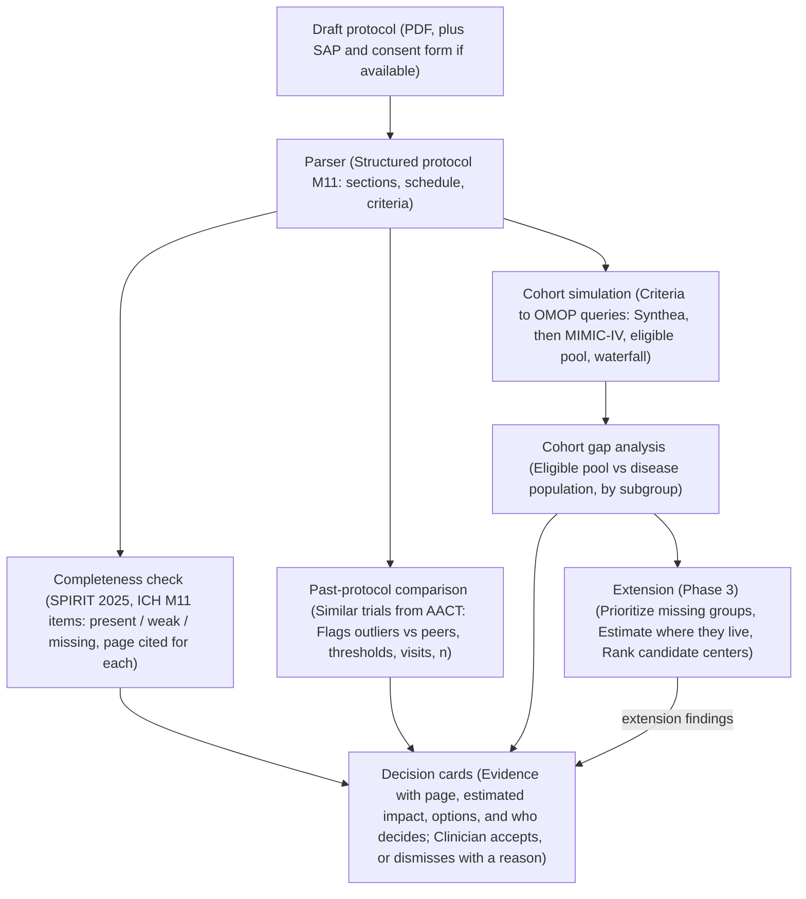

# Protocol Gap Agent — Project Plan

## System Design

## Abstract

Clinical trial protocols are often amended and often fail to enroll: 57% have at least one substantial amendment, about 45% of those amendments are avoidable, and about 18% of cooperative-group cancer trials close for low accrual or fall far behind target. Many of these problems are visible in the protocol before the trial starts.

We propose an agent that reviews a draft protocol in four steps:

1. **Completeness**: checks the protocol against the SPIRIT 2025 checklist and the ICH M11 template, and flags missing or weak elements (e.g. no estimand, no stopping rule).
2. **Comparison with past protocols**: retrieves similar trials from ClinicalTrials.gov and flags where this protocol is unusual: stricter thresholds, heavier visit schedules, optimistic sample-size assumptions.
3. **Cohort completeness**: converts the eligibility criteria into computable queries, simulates them on patient data, and shows which patient groups are under-represented compared with the disease population, and which criteria cause it.
4. **Extension, locating missing patients**: estimates where the excluded or under-represented patients are, ranks candidate centers by likelihood of reaching them, and prioritizes subgroups by their importance to the trial.

Each finding is a decision card: the evidence (page and section), the estimated impact, options, and who decides. The agent proposes; clinicians decide. We evaluate it retrospectively on completed trials, asking whether it would have flagged the criteria that were later amended, predicted terminations for low accrual, and matched the demographics that actually enrolled.

## Does the Idea Hold Up?

Yes. The four parts ask one question at widening scope: is this protocol complete, typical, inclusive, and recruitable? The core runs entirely on public data, and completed trials give us a built-in way to validate it.

Three points need sharpening before we build:

1. **"Similar past protocols" needs a definition.** Similar = same condition, same phase, same intervention class, started in the last ~10 years. The comparison flags outliers; it doesn't call them errors. Common is not the same as correct, and a stricter threshold can be deliberate.
2. **"Cohort completeness" means coverage of the intended-use population, not everyone.** We compare the simulated eligible pool with everyone who has the disease, subgroup by subgroup: age, sex, race/ethnicity, kidney/liver function, comorbidities. A gap is a subgroup whose share drops sharply between the two, traced back to the criteria that cause the drop.
3. **"Priority of missing patients" needs explicit, adjustable weights.** Proposed factors:

| Factor | Question it answers | Example |
| :--- | :--- | :--- |
| **Disease burden** | How big a share of patients with the disease is this group? | Patients 65+ in lung cancer |
| **Clinical and safety relevance** | Do we need data on this group to use the drug safely? | Renal impairment for a renally cleared drug; elderly patients (ICH E7) |
| **Regulatory expectation** | Do regulators expect this group to be represented? | Groups named in a Diversity Action Plan |
| **Statistical need** | Does the analysis plan pre-specify this subgroup? | A subgroup analysis that needs a minimum `n` |
| **Scientific value** | Might the drug work differently in this group? | Biomarker-defined groups, known effect modifiers |

The priority score is a weighted sum of these factors. The clinical lead sets the weights and the tool shows them, so nobody mistakes the ranking for an objective truth.

**What to watch:** The locating step (extension) only has county-level public data, so its output is an estimate. Scope is the biggest risk for five people, so we build the core end to end on one disease area before adding anything else.

## Data Sources

Everything the core needs is public or open after a short credentialing step. The extension adds public, county-level population data.

| Source | Used for | Access | Phase |
| :--- | :--- | :--- | :--- |
| **[AACT](https://aact.ctti-clinicaltrials.org/)** (ClinicalTrials.gov as Postgres) | Criteria, sites, status, termination reasons, enrolled baseline demographics | Public | Core |
| **ClinicalTrials.gov protocol and SAP PDFs** | Corpus of past protocols for comparison | Public | Core |
| **ClinicalTrials.gov History of Changes** | Ground truth for which criteria were later amended | Public | Core (evaluation) |
| **SPIRIT 2025 checklist, ICH M11 template** | Completeness rubric | Public | Core |
| **Synthea** | Synthetic patients to develop the pipeline (not for conclusions) | Public | Core |
| **MIMIC-IV** | Real EHR data for cohort simulation | PhysioNet credentialing (CITI training) | Core |
| **OMOP vocabularies (Athena)** | Concept sets for computable criteria | Free registration | Core |
| **All of Us** | More diverse real-world data | Researcher application | Phase 2 |
| **FDA Drug Trials Snapshots** | Enrolled demographics of pivotal trials | Public | Phase 2 (evaluation) |
| **SEER / US Cancer Statistics, CDC PLACES** | Disease burden by county | Public | Extension |
| **Census ACS** | Demographics by county | Public | Extension |
| **CMS Part D prescribers, Medicare physician data, NPPES** | Which doctors treat the disease, and where | Public | Extension |

> [!NOTE]
> MIMIC-IV is a single center and mostly ICU patients, so it is not representative of most outpatient trial populations. Use it to test the method, and state that limit in every result.
