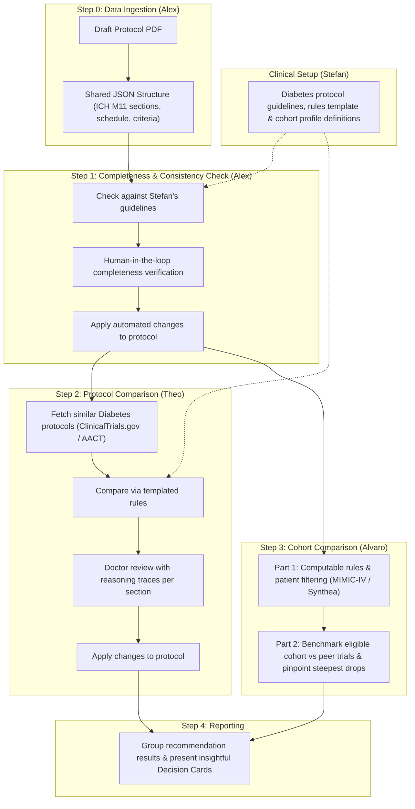

# Protocol Gap Agent — Project Plan

## Problem & Goal

Clinical trial protocols are frequently amended and often fail to enroll:
- **57%** of protocols have at least one substantial amendment, and approximately **45%** of those amendments are avoidable.
- Around **18%** of cooperative-group clinical trials close due to low accrual or fall far behind target enrollment.
- Many of these bottlenecks, inconsistencies, and recruitment gaps are detectable directly in the protocol text before trial launch.

**Disease Area:** **Diabetes** (selected as our focus area for the end-to-end hackathon pipeline).

**Core Loop:**
1. **Draft Protocol In:** Input draft protocol PDF (plus SAP and consent forms).
2. **Multi-Agent Evaluation:** Specialized agents analyze protocol completeness/consistency, benchmark against historical peer trials, and simulate patient cohort eligibility.
3. **Human-in-the-Loop Review:** Clinicians review structured findings and reasoning traces (Decision Cards).
4. **Actionable Output:** Automated amendments applied to the structured protocol alongside an actionable final recommendation report.

---

## System Architecture

---

## Pipeline Steps & Team Tasks

### 1. Define Protocol Information (Stefan)
- [x] Choose disease area: **Diabetes**
- [ ] Search source of protocols:
  - [ ] Patient profile information per cohort
  - [ ] Protocol-related data
- [ ] Define guidelines of the protocol (SPIRIT 2025 / ICH M11 rubric)
- [ ] Create a set of rules template for the agents to analyze (~10 core clinical dimensions: lab thresholds like eGFR/HbA1c, age limits, washout periods, exclusion count, visit schedule, sample size assumptions, endpoints, duration)
- [ ] Find an example Diabetes protocol to test end-to-end

### 2. Zero Step: Data Ingestion (Alex)
- [ ] Parse protocol PDFs into a shared JSON structure (`ProtocolDocument`: sections mapped to ICH M11 headings, Schedule of Activities table, and discrete eligibility criteria items with verbatim page citations).

### 3. First Step: Completeness and Consistency Check (Alex)
- [ ] Apply completeness & consistency checker based on Stefan's guidelines (score items as `present`, `weak`, or `missing` with page quotes; cross-check endpoints, schedule table, and consent form for contradictions).
- [ ] Add human-in-the-loop verification:
  - [ ] If necessary, the human adds missing information that the agent cannot extract.
- [ ] Apply automated changes to the protocol `(A)`.

### 4. Second Step: Protocol Comparison — Agent 2 (Theo)
- [ ] Fetch similar cohort protocols from ClinicalTrials.gov / AACT (same condition: Diabetes, same phase, same intervention class, last ~10 years) `(A)`.
- [ ] Compare draft protocol against previous protocols using Stefan's templated rules (flagging outliers outside peer 10th–90th percentiles) `(A)`.
- [ ] Format results based on the shared decision template `(A)`.
- [ ] Add human-in-the-loop doctor review of templated results with reasoning traces associated with each section.
- [ ] Apply approved changes to the protocol `(A)`.

### 5. Third Step: Cohort Comparison (Alvaro)

#### Part 1 — Rules & Patient Filtering
- [ ] Turn protocol eligibility values into computable rules (concept, threshold, time window, negation → OMOP / SQL filters; mark unexpressible criteria as `"cannot simulate"`).
- [ ] Filter patients from the eligible cohort.
- [ ] Fetch similar previous cohorts.
- [ ] Fetch patient variables (demographics: age, sex, race/ethnicity; labs & comorbidities).
- [ ] Filter MIMIC-IV (and Synthea dev) data according to those values to produce an attrition waterfall.

#### Part 2 — Diversity, Representation & Peer Benchmarking
- [ ] Compare simulated cohort to previous trials (test for similar diversity, representation, and recruitment feasibility).
- [ ] Name the criteria that drive the biggest drops. Run peer trials' criteria on the same simulated cohort so each result is benchmarked: the share of patients and of each subgroup this protocol keeps compared with similar trials, and which criteria explain the difference (separating strict-but-normal field criteria from trial-specific bottlenecks).

### 6. Fourth Step: Reporting (Team)
- [ ] Group recommendation results into structured **Decision Cards** (verbatim evidence + page, estimated impact, options, and decision owner; dismissed findings require a reason).
- [ ] Present insightful summary information for the clinical team.

### 7. Pitch Deck (Team)
- [ ] User Journey
- [ ] Valid metrics
