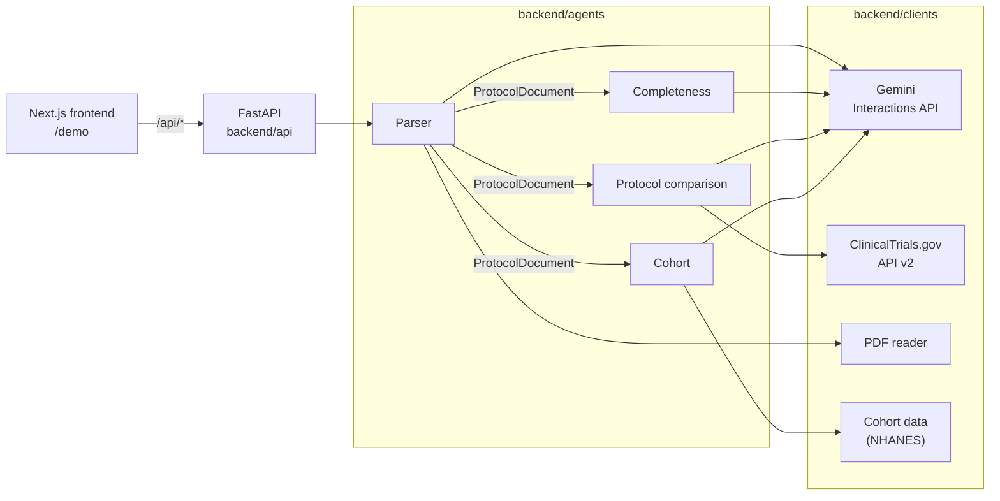

# Protocol Gap Agent

**A multi-agent reviewer that finds the gaps in a draft diabetes clinical
trial protocol before the trial starts, with a doctor in the loop for
every change.** Built for the Agentverse UCL hackathon.

Clinical trial protocols are amended often and fail to recruit often:

- **57%** of protocols have at least one substantial amendment, and about
  **45%** of those amendments are avoidable.
- About **18%** of cooperative-group trials close because they cannot
  recruit enough patients.

Many of these problems are visible in the protocol text itself. Protocol
Gap Agent reads the PDF, checks it against regulatory guidance, compares it
with similar past trials, and simulates who it would actually enroll. Every
finding comes back as a **Decision Card**: a verbatim quote, the page it
came from, the reasoning, and options for a clinician to accept or reject.

---

## Contents

- [Core features](#core-features)
- [Architecture](#architecture)
- [How we use Gemini](#how-we-use-gemini)
- [Tech stack and packages](#tech-stack-and-packages)
- [Repository layout](#repository-layout)
- [Getting started](#getting-started)
- [Commands](#commands)
- [Configuration and deployment](#configuration-and-deployment)
- [Roadmap and extensions](#roadmap-and-extensions)
- [Team](#team)
- [Contributing](#contributing)

---

## Core features

The demo walks through one protocol in four steps. Each step is one agent,
and each returns the same `StepData` shape to the UI.

### 0. Ingest: parse the protocol (Alex)

`backend/agents/parser/`

- Turns a protocol PDF into a typed `ProtocolDocument`, mapped to ICH M11
  section headings.
- Extracts **11 facets** in parallel: design, eligibility criteria,
  sections, endpoints, schedule of activities, statistics, estimands,
  interventions, analysis plan, synopsis consistency and safety
  monitoring.
- **Every extracted fact carries a verbatim quote and a page number**, and
  each quote is checked against the PDF text. Unverified quotes are
  reported, never silently kept.
- Sanity rules catch impossible values, such as a maximum age below the
  minimum age.

### 1. Check: completeness and consistency (Alex, rules by Stefan)

`backend/agents/completeness/`

- Checks the parsed protocol against **283 rules** in `rules.toml`,
  sourced from the ICH M11 template, the EMA diabetes guideline, FDA
  guidance, ICH E9(R1), FDAAA, SPIRIT and ClinicalTrials.gov registration
  requirements.
- Rule families: registration (REG), M11 structure (M11), estimands (EST),
  cross-section consistency (XS), diabetes-specific (DM), eligibility
  quality (ELQ), exclusion (EX) and amendments (AMD).
- Which rules apply is decided from the trial's profile (drug class,
  phase, control type and so on). Deterministic checks run in code;
  judgement checks go to Gemini in batches.
- **Second opinion:** every flagged judgement is re-checked by a second
  Gemini call, and the UI shows why it was confirmed.
- Returns a completeness score plus registration and review gates. Each
  finding comes with its evidence, location and a proposed fix.

### 2. Peers: comparison with similar trials (Theo)

`backend/agents/protocol_comparison/`

- Compares **the uploaded protocol's parsed values** with similar past
  trials from **ClinicalTrials.gov** on 7 dimensions: minimum and maximum
  age, enrollment, HbA1c lower and upper bounds, ALT/AST limit and eGFR
  cut-off.
- The protocol's ages, enrollment and drugs come from the parser. Its lab
  limits are read from its parsed eligibility criteria. Peers' values come
  from their registry records.
- Each peer is weighted by how close it is (same drug 1.0, same class 0.6,
  same disease 0.3), how recent it is (5-year half-life) and whether it is
  still running.
- A value is flagged when it falls outside the peers' weighted 10th to
  90th percentile range, or, when evidence is thin, beyond every peer.
  The amount of evidence is measured with Kish's effective sample size.
- Each flag comes with values suggested from peers, a peer table and
  chart, and a link to every registry record.
- The rules are documented in
  [`docs/protocol_comparison_rules.md`](docs/protocol_comparison_rules.md).

### 3. Cohort: who would actually enroll (Alvaro)

`backend/agents/cohort/`

- Turns eligibility criteria into computable rules (concept, threshold,
  time window, negation). It compiles them deterministically first and
  asks Gemini only about the criteria it cannot resolve. Criteria that
  cannot be simulated are marked for doctor review.
- Filters a real-world diabetes cohort (CDC NHANES) into an **attrition
  waterfall** showing how many patients each criterion removes.
- Benchmarks the result against peer trials' criteria on the same cohort,
  separating criteria that are normal for the field from trial-specific
  bottlenecks.

### 4. Review: the Decision Cards UI (Raul)

`frontend/`

- A Next.js `/demo` page that uploads a PDF and shows each step as it
  completes.
- **Decision Cards** show evidence with page references, a reasoning
  trace, impact metrics, charts and options for the reviewer.

---

## Architecture



How a review flows:

1. **Upload.** `POST /api/upload-file` parses the PDF into a
   `ProtocolDocument` and starts the completeness check in the
   background.
2. **Three steps in parallel.** The UI calls
   `/api/checklist-recommendation`, `/api/protocol-recommendation` and
   `/api/cohort-recommendation`. Each takes the same parsed document, and
   each is safe to call twice.
3. **Decision Cards.** `backend/api/` maps each agent's output to
   `StepData`, the one contract the frontend depends on.

The rules that hold the system together:

- **One shared contract.** Every model the agents exchange lives in
  `backend/shared/messages.py`.
- **Agents never import each other.** They import only from `shared/` and
  `clients/`; the API layer calls each agent's async entry point.
- **Pure logic in the middle, I/O at the edges.** Each agent has
  `agent.py` (I/O wiring), `logic.py` (pure functions) and `prompts.py`
  (prompt constants).
- **Every external call goes through `backend/clients/`**, so timeouts,
  retries and test doubles live in one place.

---

## How we use Gemini

All LLM work runs on **Gemini (`gemini-4-argon` by default)** through the
**Gemini Interactions API** (`google-genai`), behind one client in
`backend/clients/gemini.py`. The aim is to spend a Gemini call only where
judgement is needed, and never to trust an answer we cannot check.

**Structured output only.** Every call goes through
`generate_json(prompt, ResponseModel)`. The reply is parsed into a
Pydantic model, so agents never handle free text and malformed output is
rejected at the boundary.

**A reasoning budget per task.** Each call sets a `thinking_level` (`low`,
`medium` or `high`). Hard reads such as eligibility criteria and
judgement checks use `high`; simpler extractions use `medium`.

**Parallel, within the rate limit.**

- Parser facets and completeness batches run concurrently with
  `asyncio.gather`.
- A shared semaphore caps the client at **12 concurrent calls**, so a full
  parse and a full check fit together without hitting Gemini's rate
  limit.
- Rate limits, timeouts and server errors are **retried 3 times with
  exponential backoff**. Each call has a **300-second timeout**, sized
  for protocols of 100k+ tokens.

**Grounded answers.**

- Pages are sent with numbered markers (`backend/shared/prompting.py`),
  and every quote Gemini returns is checked against that page's text
  (`backend/shared/citations.py`).
- In the comparison agent, a lab limit is kept only if its quote appears
  in the criteria text, and units are converted in code, never by the
  model.

**Deterministic first, LLM second.**

- The comparison's statistics (weights, percentiles, effective sample
  size) are pure Python. Gemini only reads lab limits out of free-text
  criteria.
- The cohort agent compiles criteria with rules first and asks Gemini only
  about the ones left unresolved.
- Completeness rules that can be checked in code never reach Gemini.

**Never pay twice for the same answer.**

- Parsing is cached by a hash of the PDF's bytes, and checking by a hash
  of the parsed content. Concurrent requests for the same input share one
  run (`backend/shared/task_cache.py`).
- Complete results are saved to disk (`RESULT_CACHE_DIR`). Each store is
  versioned by a fingerprint of the agent's code, prompts, output schema
  and model name, so changing a prompt invalidates old results
  automatically. Incomplete runs are shown, then rerun next time.
- Peer trials' lab-limit readings are cached per trial, keyed by a hash of
  the criteria text and the prompt, and committed in `data/peers/`.

**Failures stay visible.** One failed call never hides the other results:
the step is marked `PARTIAL` with a warning that says what is missing, and
each agent's entry point raises a specific, documented exception to its
caller.

---

## Tech stack and packages

### Backend (Python 3.14, managed with `uv`)

| Package | Used for |
| :--- | :--- |
| `fastapi`, `uvicorn` | HTTP API and server |
| `pydantic`, `pydantic-settings` | Typed models at every boundary; settings from `.env` |
| `google-genai` | Gemini Interactions API client |
| `httpx` | ClinicalTrials.gov API v2 client |
| `pypdf` | PDF text extraction |
| `python-multipart` | PDF uploads |

### Frontend (Bun)

| Package | Used for |
| :--- | :--- |
| `next` 16, `react` 19 | App framework and the `/demo` page |
| `tailwindcss` 4, `radix-ui`, `lucide-react` | Styling, accessible components, icons |
| `three` | Animated protein visual on the landing page |
| `@testing-library/react`, `jsdom` | Workflow and contract tests with `bun test` |

### Development tooling

| Tool | Role |
| :--- | :--- |
| `ruff` | Formatting and linting (79-character lines) |
| `mypy` | Type checking |
| `pytest`, `pytest-asyncio` | Backend tests; live and extended tests are opt-in |
| `pre-commit` | Runs ruff and mypy on every commit |
| `watchfiles` | Hot reload for `make dev` |
| `fpdf2` | Synthetic PDFs for tests |
| GitHub Actions | Format, lint, types, tests and frontend build on every PR; deploys to Vercel |

### Data sources

| Source | Role |
| :--- | :--- |
| ClinicalTrials.gov API v2 | Peer trials for the comparison step (snapshot in `data/peers/`) |
| CDC NHANES | Diabetes patient cohort for the enrollment simulation (`data/cohort/`) |
| ICH M11, ICH E9(R1), EMA and FDA guidance, FDAAA, SPIRIT | Completeness rule catalogue |
| Demo protocols | `data/protocols/demo/`: canagliflozin in pediatric T2D, and FAME-D |

---

## Repository layout

```text
.
├── frontend/                     # Next.js UI; talks to backend/api only
├── backend/
│   ├── api/                      # HTTP routes, step adapters, analysis pipeline
│   ├── agents/
│   │   ├── parser/               # Step 0: PDF -> ProtocolDocument
│   │   ├── completeness/         # Step 1: rule catalogue check
│   │   ├── protocol_comparison/  # Step 2: comparison with peer trials
│   │   └── cohort/               # Step 3: cohort simulation
│   ├── clients/                  # Gemini, ClinicalTrials.gov, PDF, cohort data
│   ├── shared/                   # messages.py (the contract), config, caches
│   └── main.py                   # starts the API
├── api/index.py                  # Vercel serverless entry point
├── data/
│   ├── protocols/                # demo and synthetic sample protocol PDFs
│   ├── peers/                    # committed ClinicalTrials.gov peer snapshot
│   └── cohort/                   # NHANES cohort and peer protocols
├── docs/                         # agent rule write-ups
├── tests/                        # mirrors backend/; live and extended markers
├── scripts/                      # generators (synthetic sample protocol)
├── PROJECT.md                    # full plan, task lists, evaluation metrics
├── CONVENTIONS.md                # coding rules every contributor follows
└── Makefile                      # every command
```

---

## Getting started

### Prerequisites

- [**uv**](https://docs.astral.sh/uv/), which installs Python 3.14 for
  you
- [**Bun**](https://bun.sh/) for the frontend
- A **Gemini API key** for parsing and analysis. The test suite runs
  without one.

### Install

```bash
git clone https://github.com/elmerescandon/spanish-ai-agentverse.git
cd spanish-ai-agentverse
make install            # uv sync + pre-commit hooks + frontend packages
cp .env.example .env    # then set GEMINI_API_KEY
```

### Run locally

In two terminals:

```bash
make dev                # backend on http://localhost:8000, hot reload
make dev-frontend       # frontend on http://localhost:3000
```

Open <http://localhost:3000/demo> and upload
`data/protocols/demo/NCT03170518_protocol.pdf`.

- The first parse of a PDF takes a few minutes. Uploading the same PDF
  again is served from the cache.
- Set `RESULT_CACHE_DIR=data/cache` in `.env` to keep results across
  restarts, and run `make clear-cache` to force a fresh analysis.

### Test

```bash
make check              # format + lint + types + tests; run before every push
make test               # backend and frontend tests only (fast, no network)
make test-extended      # adds slow checks on the real demo PDFs (what CI runs)
make test-live          # real Gemini and ClinicalTrials.gov calls (needs a key)
```

`make test-live` runs the demo path end to end on both demo PDFs (upload,
completeness check and comparison) and takes several minutes per PDF.

---

## Commands

| Command | What it does |
| :--- | :--- |
| `make install` | Install backend and frontend dependencies and pre-commit hooks |
| `make dev` | Run the backend with hot reload |
| `make dev-frontend` | Run the Next.js dev server |
| `make run` | Run the backend once, without reload |
| `make parse PDF=path.pdf` | Parse one PDF from the command line |
| `make format` | `ruff format` + `ruff check --fix` |
| `make lint` | ruff, mypy, eslint and TypeScript checks |
| `make test` | Fast backend and frontend tests |
| `make test-extended` | Tests plus slow checks on the real demo PDFs |
| `make test-live` | Live tests against real APIs |
| `make check` | format + lint + test |
| `make demo` | Live tests, then run the backend (use on stage) |
| `make demo-peers` | Refresh the committed peer snapshot from ClinicalTrials.gov |
| `make clear-cache` | Delete saved analyses in `data/cache` |
| `make sample-protocol` | Regenerate the synthetic sample protocol PDF |

---

## Configuration and deployment

### Backend (`.env` at the repository root)

Copy `.env.example` to `.env`; every key the backend reads is listed
there.

| Variable | Default | Description |
| :--- | :--- | :--- |
| `GEMINI_API_KEY` | *(none)* | Gemini API key; required for parsing and analysis |
| `GEMINI_MODEL` | `gemini-4-argon` | Gemini model identifier |
| `RESULT_CACHE_DIR` | *(none)* | Folder for finished parses and checks; unset keeps them in memory only |
| `BACKEND_HOST` | `0.0.0.0` | Interface the FastAPI server binds to |
| `BACKEND_PORT` | `8000` | FastAPI server port |
| `ALLOWED_ORIGINS` | `http://localhost:3000,http://127.0.0.1:3000` | Comma-separated CORS origins |
| `FASTAPI_URL` | `http://127.0.0.1:8000` | Backend URL the Next.js `/api/*` proxy forwards to |
| `AACT_DB_URL` | *(none)* | PostgreSQL URL for ClinicalTrials.gov AACT (planned) |
| `MIMIC_DATA_PATH` | *(none)* | Path to MIMIC-IV data (planned) |
| `SYNTHEA_DATA_PATH` | *(none)* | Path to Synthea synthetic data (planned) |

### Deployment (Vercel)

`vercel.json` deploys two services from one repository: the FastAPI
backend (`backend.main:app`) and the Next.js frontend. Requests to
`/api/*` go to the backend and everything else to the frontend; Vercel
passes the backend's URL to the frontend as `FASTAPI_URL`. CI deploys
`main` to production once its checks pass.

> Never prefix backend secrets with `NEXT_PUBLIC_`. Keep API keys on the
> backend only.

The deployed filesystem is read-only, so the comparison step reads peers
from the committed snapshot in `data/peers/` and keeps new lab readings in
memory.

---

## Roadmap and extensions

What we want to add next, roughly in priority order:

- [ ] **Peer search built from the protocol.** Choose comparison trials
      from the parsed protocol's condition, phase, population and date,
      instead of the demo's fixed search.
- [ ] **Apply approved changes.** Turn accepted Decision Cards into an
      amended, redlined protocol, then re-run the checks on it.
- [ ] **Comparison reasoning in the UI.** Turn on Gemini's written
      reasoning for each comparison flag (implemented, off for speed).
- [ ] **Reasons for dismissed findings.** Require and record a reason
      whenever a reviewer rejects a Decision Card.
- [ ] **More comparison dimensions.** Washout periods, visit burden,
      exclusion count, study duration and sample-size assumptions.
- [ ] **eGFR equation awareness.** Compare eGFR cut-offs only between
      trials that use the same equation (CKD-EPI or MDRD).
- [ ] **AACT and History of Changes.** Measure how often our flags match
      criteria that real trials later amended.
- [ ] **MIMIC-IV and Synthea cohorts,** with OMOP concept sets, alongside
      NHANES.
- [ ] **Persistent reviews.** Store protocols and reviewer decisions in a
      database instead of memory, with a full audit trail.
- [ ] **Beyond diabetes.** Rule catalogues and peer criteria for other
      therapeutic areas.

See [PROJECT.md](PROJECT.md) for the full plan, task lists and evaluation
metrics.

---

## Team

| Area | Owner |
| :--- | :--- |
| Clinical rules and guidelines | Stefan |
| Parser and completeness check | Alex |
| Protocol comparison | Theo |
| Cohort simulation | Alvaro |
| Frontend, reporting and deployment | Raul |

---

## Contributing

Read [CONVENTIONS.md](CONVENTIONS.md) before writing code. In short:

- Branch from `main` as `name/short-description`; never push to `main`.
- Run `make check` before every push. CI runs format, lint, types and
  tests on every PR.
- Changes to `backend/shared/messages.py` or `backend/api/` affect
  everyone, so flag them in the PR.
- AI coding tools follow the same rules ([CLAUDE.md](CLAUDE.md),
  [AGENTS.md](AGENTS.md)).
