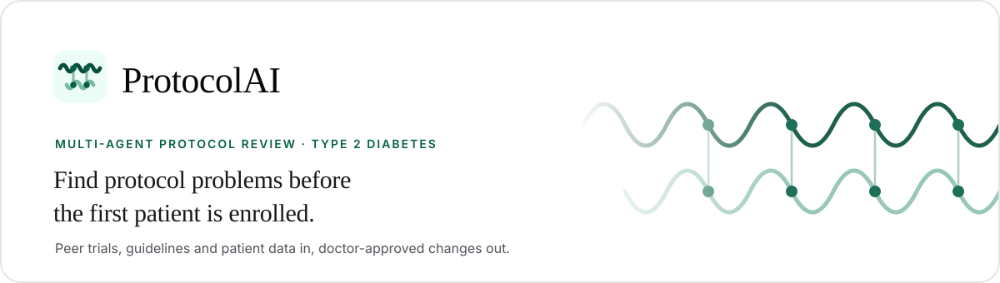
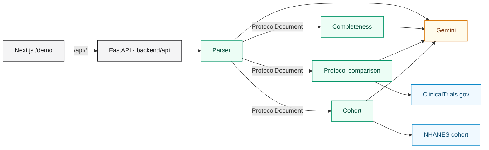

<p align="center">
  
</p>

<p align="center">
  <a href="https://protocol-ai-rho.vercel.app"><b>Live demo</b></a> ·
  <a href="#how-it-works">How it works</a> ·
  <a href="#getting-started">Getting started</a> ·
  <a href="PROJECT.md">Project plan</a>
</p>

<p align="center">
  <a href="https://github.com/elmerescandon/spanish-ai-agentverse/actions/workflows/ci.yml"></a>
  
  
  
  
  
</p>

---

More than half of trial protocols need amendments mid-study. **ProtocolAI**
checks a draft type 2 diabetes protocol against regulatory guidelines,
peer trials and real patient data, then gives doctors clear cards to act
on.

| 57% | 45% | 18% |
| :---: | :---: | :---: |
| Need major amendments | Could have been avoided | Close early for low enrollment |

<sub>Sources: Getz et al., Tufts CSDD (2024); Wong et al., JNCI (2020).</sub>

## How it works

From draft protocol to doctor-approved changes, in five steps. Each step
is one agent, and each returns the same `StepData` shape to the UI.

| | Step | What it does | Agent |
| :---: | :--- | :--- | :--- |
| **01** | **Understand the protocol** | Parses the PDF into a typed `ProtocolDocument`: 11 facets under ICH M11 headings. Every fact has a quote and a page, checked against the PDF text. | `parser/` · Alex |
| **02** | **Find missing or conflicting parts** | Checks the protocol against 283 rules from ICH M11, EMA and FDA guidance, ICH E9(R1), FDAAA and SPIRIT. Every flag gets a second Gemini opinion. | `completeness/` · Alex, Stefan |
| **03** | **Compare with similar trials** | Compares the protocol's ages, enrollment and lab limits with similar ClinicalTrials.gov trials, weighted by drug, class and recency. Flags values outside the peers' 10th to 90th percentile. | `protocol_comparison/` · Theo |
| **04** | **Count the patients you would lose** | Turns eligibility criteria into computable rules and runs them on a CDC NHANES diabetes cohort, showing which criteria remove the most patients. | `cohort/` · Alvaro |
| **05** | **Doctors make the call** | Each finding becomes a Decision Card with its quote, page, reasoning and options. Nothing changes without physician sign-off. | `frontend/` · Raul |

### Every finding points to real data

| Source | Role |
| :--- | :--- |
| **ClinicalTrials.gov** | Peer type 2 diabetes trials to compare against (snapshot in `data/peers/`) |
| **ICH M11, SPIRIT 2025, EMA and FDA guidance** | The checklist of what a complete protocol must contain |
| **CDC NHANES** | Real patients to test who would qualify (`data/cohort/`) |

### Built so doctors stay in control

- **No silent guesses.** Anything we cannot simulate or verify is labelled
  as such.
- **Visible logic.** Each card shows the reasoning next to the protocol
  text it quotes.
- **Physician sign-off.** The tool suggests; clinicians decide. Safety
  criteria are never relaxed automatically.

## Architecture



1. `POST /api/upload-file` parses the PDF and starts the completeness
   check in the background.
2. The UI requests the three analysis steps
   (`/api/checklist-recommendation`, `/api/protocol-recommendation`,
   `/api/cohort-recommendation`). Each runs on the same parsed document
   and is safe to call twice.

Every shared model lives in `backend/shared/messages.py`; agents never
import each other; each agent splits `agent.py` (I/O), `logic.py` (pure
functions) and `prompts.py`; every external call goes through
`backend/clients/`.

## How we use Gemini

All LLM calls go to **Gemini (`gemini-4-argon`)** through the Interactions
API, behind one client in `backend/clients/gemini.py`.

- **Structured output.** Every reply is parsed into a Pydantic model;
  malformed output is rejected.
- **Reasoning per task.** Each call sets a thinking level: `high` for hard
  reads such as eligibility criteria, `medium` for simple extraction.
- **Parallel within limits.** Facets and rule batches run concurrently,
  capped at 12 calls at once, with 3 retries (exponential backoff) and a
  300-second timeout.
- **Grounded.** Every quote Gemini returns is checked against the page it
  cites; units are converted in code, not by the model.
- **Deterministic first.** Statistics and code-checkable rules never reach
  Gemini; it handles only free text and judgement.
- **Cached.** Parses and checks are cached by content and versioned by a
  fingerprint of the agent's code, prompts and model, so a prompt change
  invalidates old results.
- **Failures stay visible.** A failed call marks the step `PARTIAL` with a
  warning instead of hiding the other results.

## Tech stack

| Layer | Stack |
| :--- | :--- |
| Backend | Python 3.14 (`uv`), FastAPI, Pydantic, `google-genai`, `httpx`, `pypdf` |
| Frontend | Next.js 16, React 19, Tailwind 4, Radix UI, Bun |
| Quality | ruff (79-character lines), mypy, pytest, pre-commit, GitHub Actions |
| Hosting | Vercel (backend and frontend from one repository) |

```text
backend/
├── api/        # routes, step adapters, analysis pipeline
├── agents/     # parser, completeness, protocol_comparison, cohort
├── clients/    # Gemini, ClinicalTrials.gov, PDF reader, cohort data
└── shared/     # messages.py (the contract), config, caches
frontend/       # Next.js UI; talks to backend/api only
tests/          # mirrors backend/
```

## Getting started

You need [uv](https://docs.astral.sh/uv/), [Bun](https://bun.sh/) and a
Gemini API key (tests run without one).

```bash
git clone https://github.com/elmerescandon/spanish-ai-agentverse.git
cd spanish-ai-agentverse
make install            # backend and frontend dependencies, pre-commit
cp .env.example .env    # then set GEMINI_API_KEY

make dev                # backend on http://localhost:8000
make dev-frontend       # frontend on http://localhost:3000
```

Open <http://localhost:3000/demo> and upload
`data/protocols/demo/NCT03170518_protocol.pdf`. The first parse takes a
few minutes; set `RESULT_CACHE_DIR=data/cache` to keep results across
restarts.

| Command | What it does |
| :--- | :--- |
| `make check` | Format, lint, types and tests; run before every push |
| `make test` | Fast backend and frontend tests |
| `make test-extended` | Adds slow checks on the real demo PDFs (what CI runs) |
| `make test-live` | Full demo path with real Gemini calls (minutes per PDF) |
| `make demo` | Live tests, then run the backend (use on stage) |
| `make demo-peers` | Refresh the peer snapshot from ClinicalTrials.gov |
| `make clear-cache` | Delete saved analyses |

Every environment variable is documented in `.env.example`. On Vercel,
`vercel.json` routes `/api/*` to the backend and everything else to the
frontend, and CI deploys `main` once checks pass. Never prefix backend
secrets with `NEXT_PUBLIC_`.

## Roadmap

- [ ] Choose peer trials from the protocol's own condition, phase and date
- [ ] Turn accepted Decision Cards into an amended, redlined protocol
- [ ] Show Gemini's reasoning on comparison flags (built, off for speed)
- [ ] Require a reason when a reviewer dismisses a finding
- [ ] More comparison dimensions: washout, visit burden, duration
- [ ] Compare eGFR cut-offs only between trials using the same equation
- [ ] Validate flags against amendments in AACT's History of Changes
- [ ] MIMIC-IV and Synthea cohorts alongside NHANES
- [ ] Store reviews in a database with an audit trail
- [ ] Therapeutic areas beyond diabetes

## Contributing

Read [CONVENTIONS.md](CONVENTIONS.md) first. Branch as
`name/short-description`, run `make check` before pushing, and flag any
change to `backend/shared/messages.py` or `backend/api/` in your PR.

<p align="center"><sub>ProtocolAI · Built at the Agentverse UCL hackathon by Alex, Alvaro, Raul, Stefan and Theo.</sub></p>
