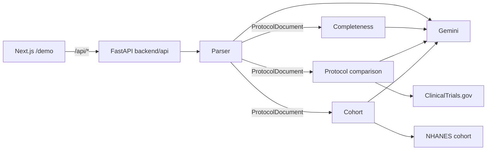

# Protocol Gap Agent

**A multi-agent reviewer that finds the gaps in a draft diabetes clinical
trial protocol before the trial starts, with a doctor in the loop for
every change.** Built for the Agentverse UCL hackathon.

57% of protocols have a substantial amendment (about half avoidable), and
about 18% of trials close because they cannot recruit. Many of these
problems are visible in the protocol text. Protocol Gap Agent reads the
PDF, checks it against regulatory guidance, compares it with similar past
trials and simulates who it would enroll. Every finding is a **Decision
Card**: a verbatim quote, its page, the reasoning and options for a
clinician.

## Core features

| Step | Agent | What it does |
| :--- | :--- | :--- |
| 0. Ingest | `parser/` (Alex) | Parses the PDF into a typed `ProtocolDocument` (11 facets, ICH M11 headings). Every fact has a quote and page, checked against the PDF text. |
| 1. Check | `completeness/` (Alex, rules by Stefan) | Checks the protocol against 283 rules from ICH M11, EMA and FDA guidance, ICH E9(R1), FDAAA and SPIRIT. Flags get a second Gemini opinion; returns a score, gates and proposed fixes. |
| 2. Peers | `protocol_comparison/` (Theo) | Compares the protocol's parsed values (ages, enrollment, HbA1c, ALT/AST, eGFR) with similar ClinicalTrials.gov trials, weighted by drug, class and recency. Flags values outside the peers' 10th to 90th percentile. |
| 3. Cohort | `cohort/` (Alvaro) | Turns eligibility criteria into computable rules and runs them on a CDC NHANES diabetes cohort, showing which criteria remove the most patients compared with peer trials. |
| 4. Review | `frontend/` (Raul) | Next.js `/demo` page that uploads a PDF and shows each step as Decision Cards with evidence, reasoning, charts and options. |

Clinical rules and guidelines are curated by Stefan. See
[PROJECT.md](PROJECT.md) for the full plan and
[`docs/protocol_comparison_rules.md`](docs/protocol_comparison_rules.md)
for the comparison rules.

## Architecture



1. `POST /api/upload-file` parses the PDF and starts the completeness
   check in the background.
2. The UI then requests the three steps (`/api/checklist-recommendation`,
   `/api/protocol-recommendation`, `/api/cohort-recommendation`). Each runs
   on the same parsed document and is safe to call twice.

Design rules: every shared model lives in `backend/shared/messages.py`;
agents never import each other; each agent splits `agent.py` (I/O),
`logic.py` (pure functions) and `prompts.py`; every external call goes
through `backend/clients/`.

## How we use Gemini

All LLM calls go to **Gemini (`gemini-4-argon`)** through the Interactions
API, behind one client in `backend/clients/gemini.py`.

- **Structured output.** Every reply is parsed into a Pydantic model;
  malformed output is rejected.
- **Reasoning per task.** Each call sets a thinking level: `high` for hard
  reads such as eligibility criteria, `medium` for simple extraction.
- **Parallel within limits.** Facets and rule batches run concurrently,
  capped at 12 calls at once, with 3 retries (exponential backoff) and a
  300-second timeout.
- **Grounded.** Every quote Gemini returns is checked against the page
  it cites; units are converted in code, not by the model.
- **Deterministic first.** Statistics and code-checkable rules never
  reach Gemini; it handles only free text and judgement.
- **Cached.** Parses and checks are cached by content and versioned by a
  fingerprint of the agent's code, prompts and model, so a prompt change
  invalidates old results. Peer lab readings are committed in
  `data/peers/`.
- **Failures stay visible.** A failed call marks the step `PARTIAL` with a
  warning instead of hiding the other results.

## Tech stack

- **Backend:** Python 3.14 with `uv`, FastAPI, Pydantic,
  `google-genai`, `httpx`, `pypdf`.
- **Frontend:** Next.js 16, React 19, Tailwind 4, Radix UI, Bun.
- **Tooling:** ruff (79-character lines), mypy, pytest, pre-commit,
  GitHub Actions CI, Vercel.
- **Data:** ClinicalTrials.gov API v2 (`data/peers/`), CDC NHANES
  (`data/cohort/`), demo protocols (`data/protocols/demo/`).

```text
backend/
├── api/        # routes, step adapters, analysis pipeline
├── agents/     # parser, completeness, protocol_comparison, cohort
├── clients/    # Gemini, ClinicalTrials.gov, PDF reader, cohort data
└── shared/     # messages.py (the contract), config, caches
frontend/       # Next.js UI; talks to backend/api only
tests/          # mirrors backend/
```

## Getting started

You need [uv](https://docs.astral.sh/uv/), [Bun](https://bun.sh/) and a
Gemini API key (tests run without one).

```bash
git clone https://github.com/elmerescandon/spanish-ai-agentverse.git
cd spanish-ai-agentverse
make install            # backend and frontend dependencies, pre-commit
cp .env.example .env    # then set GEMINI_API_KEY

make dev                # backend on http://localhost:8000
make dev-frontend       # frontend on http://localhost:3000
```

Open <http://localhost:3000/demo> and upload
`data/protocols/demo/NCT03170518_protocol.pdf`. The first parse takes a
few minutes; set `RESULT_CACHE_DIR=data/cache` to keep results across
restarts.

| Command | What it does |
| :--- | :--- |
| `make check` | Format, lint, types and tests; run before every push |
| `make test` | Fast backend and frontend tests |
| `make test-extended` | Adds slow checks on the real demo PDFs (what CI runs) |
| `make test-live` | Full demo path with real Gemini calls (minutes per PDF) |
| `make demo` | Live tests, then run the backend (use on stage) |
| `make demo-peers` | Refresh the peer snapshot from ClinicalTrials.gov |
| `make clear-cache` | Delete saved analyses |

All environment variables are documented in `.env.example`. On Vercel,
`vercel.json` deploys the backend and frontend together and routes
`/api/*` to the backend; CI deploys `main` once checks pass. Never prefix
backend secrets with `NEXT_PUBLIC_`.

## Roadmap

- [ ] Choose peer trials from the protocol's own condition, phase and date
- [ ] Turn accepted Decision Cards into an amended, redlined protocol
- [ ] Show Gemini's reasoning on comparison flags (built, off for speed)
- [ ] Require a reason when a reviewer dismisses a finding
- [ ] More comparison dimensions: washout, visit burden, duration
- [ ] Compare eGFR cut-offs only between trials using the same equation
- [ ] Validate flags against amendments in AACT's History of Changes
- [ ] MIMIC-IV and Synthea cohorts alongside NHANES
- [ ] Store reviews in a database with an audit trail
- [ ] Therapeutic areas beyond diabetes

## Contributing

Read [CONVENTIONS.md](CONVENTIONS.md) first. Branch as
`name/short-description`, run `make check` before pushing, and flag any
change to `backend/shared/messages.py` or `backend/api/` in your PR.
